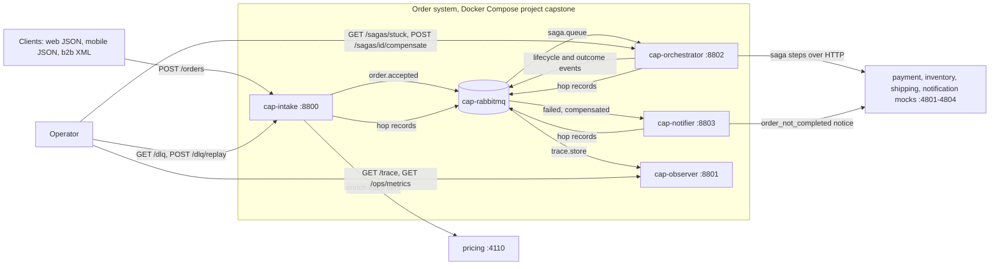
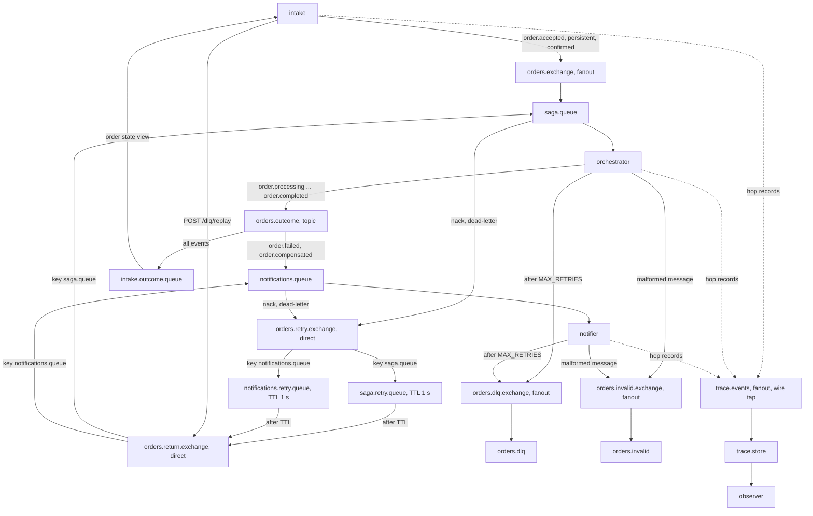

# Architecture

## System context

Clients submit orders in three formats to one intake service. Everything after that runs through RabbitMQ. The providers (payment, inventory, shipping, notification) and the pricing service are external HTTP systems, here the kit's mocks. An operator watches the system through the observer and acts through endpoints on intake and the orchestrator.

## Integration architecture

Every exchange and queue of the topology is shown. The solid paths are the business flow. The retry paths use a TTL queue and return to the origin queue only. After MAX_RETRIES attempts a message goes to the dead letter channel. A message that cannot be parsed goes to the invalid message channel and is never retried. Every service publishes hop records to the wire tap, and the observer stores them.

## Known limits

- One instance of each service. Competing consumers are not used.
- Outcome events are at-least-once. Intake and the notifier tolerate duplicates.
- Hop records are fire-and-forget on a channel without confirms, so a hop can be lost. A lost hop never fails an order.
- The saga.stuck and saga.operator_compensate hops have no causationId, because the orchestrator does not store the last hop of a crashed saga.
